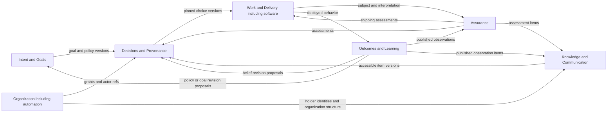

# Proposed logical context map

AE-002 keeps responsibilities in one Python simulation and proposes combining
Work/Software System ownership and keeping Automation inside Organization.
These are [tabletop-tested boundaries](../research/experiments/AE-002/tabletop.md),
not nine packages, microservices or an accepted implementation.

Arrows publish versioned references, not code imports or blanket access grants.
Consumers use an accessible view; private observations or assessment content
cannot leak through a known ID. O recognizes policy enactment authority; G owns
the enacted policy. Full ownership is in [the domain model](domain-model.md#ownership-and-command-boundaries).

Evidence crosses these boundaries without acquiring multiple mutable owners:

| Operation | Sole writer | Consumer contract / concrete failure avoided |
| --- | --- | --- |
| Publish an outcome sample | L | Pin world/deployment/observation method and times; D cannot read hidden recovery rules to fix T3 automatically. |
| Assess an implementation or proposition | A | Retain subject/version and dependencies; two T4 reports with one origin are not independent. |
| Deliver a source or assessment | K | Add recipient holding only after delivery/access succeeds; citing Ada in T1 does not transfer her knowledge. |
| Grant/revoke retry discretion | O | D records historical basis, W checks applicable permission for its own action; T2 delegation neither supplies evidence nor authorizes shipping. |
| Select/revise an option | D | Keep refs and known gaps, validate alternatives, append version; T5 lack of evidence never becomes a world harm input. |
| Revise factual belief / enact policy | L / G respectively | Learning records rationale and requests enactment; T3 observation does not itself replace the active deployment or policy. |
| Reassign work or replace an actor | O, with K/W coordination | Role, function, holdings and interrupted work need explicit transitions; no magical rationale transfer. |

The same process may hold private audit and actor-accessible views, but their
query boundaries must be explicit. Within L, World produces consequences;
Learning sees only available evidence. This split is a responsibility constraint
even if AE-010/013 implement it in one module. Application orchestrates operations;
simulation owns their rules/time and does not call outward. Adapters depend on
application, which depends on simulation, as required by ADR-001.

Open issues: transactional failure across owners (AE-007), shared evidence-ref
shape and contested lineage (AE-013), authority conflict resolution (AE-006), and
player discovery projections (AE-019/026). [ADR-006](adr/0006-context-boundaries.md)
records the alternatives and revisit triggers; none requires another package now.
