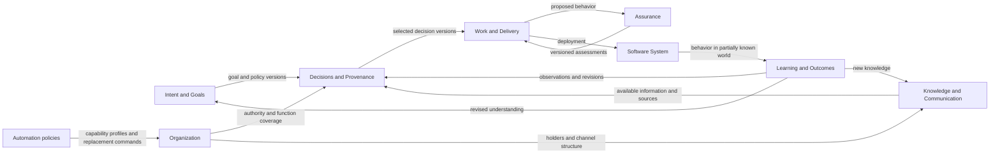

# Agent Empires — Build the MVP Campaign

Planning baseline: 2026-10-08. Campaign ID: `agent-empires-mvp`.
Status: active implementation; see the build-progress ledger. Sizes are relative,
not calendar estimates. Activity IDs are stable across revisions.

Initial audience: software engineers, managers and other IT professionals.
[Owner-directed feedback sequencing](campaigns/mvp/revisions/2026-10-09-owner-feedback.md)
permits engineering and owner review now, with unfamiliar-player validation at
the playable prototype. Neither comprehension nor enjoyment is claimed in advance.

## 1. Executive summary

Build one small, inspectable simulation about PaymentCo, then determine whether
people enjoy making and revising its organizational decisions. The first useful
result is evidence that decision closure, authority, and justified learning can
be modeled separately. It is not an API, a large domain framework, or a polished
game. Python owns the simulation; Godot 4 eventually presents it in 2D.

This campaign contains 35 bounded activities. Conceptual experiments, causal
counterexamples, and early comprehension tests precede transport and graphics.
Negative results may narrow, replace, or remove mechanics. In particular,
Assumption Debt must earn its place; it is not a required damage formula.

The [controller manifest](campaigns/mvp/campaign.json) contains the same activity
IDs, dependencies, scopes, and acceptance checks. The [handoff](campaigns/mvp/README.md)
records controller usage and execution limits. This document owns domain meaning;
controller success cannot establish scientific validity or player understanding.

### Repository inspection and reconciliation

Inspected all repository files at baseline commit
`d8b4116` (`Initial commit`): `README.md`, `.gitignore`, and `LICENSE`.
The initial working tree was clean on `main`. The README contained only the
project name and tagline. The license is Apache-2.0. The ignore file is a generic
Python template. There was no source, dependency manifest, test suite, Godot
project, scenario, architecture/planning document, or `AGENTS.md` in this repository
or its ancestor directories. There is no existing architecture to migrate.

The requested controller is `/home/senanayake/Dev/campaign-controller`, inspected
at `3c064387fb3bda108ff86dcddc6955a7568f22d8`. Read its `AGENTS.md`, README,
campaign schema, queue contract, decision-gate contract, component contract,
relevant usage instructions, and config/prompt code. Its process rules do not
supply Agent Empires' domain model. Controller source was not modified.

Observed local tools: system Python 3.14.4, `uv`, and the controller's Python
3.12.13 environment with PyYAML. No `godot` or `godot4` executable was found on
PATH. These are observations, not selected project versions. AE-001 selects and
records supported versions; installing Godot is unnecessary for early experiments.

| Conflict or uncertainty | Working resolution | Revisit |
| --- | --- | --- |
| “Use the campaign controller” versus “do not build the MVP now” | Author its actual manifest and inspect/render it; do not launch workers. | Future execution request |
| Ten humans and up to three agent types versus smallest experiment | Start with three holders and one agent policy; expand to ten humans and at most three profiles in PaymentCo. | AE-008 |
| Decision as central aggregate versus a simulation-wide transaction | Decision owns a versioned choice and justification; the application coordinates other aggregates. | AE-002, AE-007 |
| Event log versus full event sourcing | Require append-only causal history and deterministic command replay early; defer a pure event-sourced state store. | AE-003, AE-031 |
| “Declines must never be retried” versus no immutable true requirement | Make this an initial fictional PaymentCo policy with rationale, scope, and version; world evidence can challenge it. | AE-008, AE-013 |
| Hidden functions versus arbitrary gotchas | Hide undiscovered knowledge content, but expose observable dependencies, conversations, and warning signs before irreversible actions. | AE-019, AE-026 |
| Infinite autonomous evolution versus 15–20-minute MVP | Test human-only, hybrid, and fully agent-operated configurations of one finite scenario. | AE-018, AE-029 |
| Human response to automation versus small scope | Model capability, incentives, availability, and knowledge transfer first; defer generalized politics and resignation systems. | MA-13; post-MVP |
| Scenario YAML versus premature schema commitment | Propose versioned YAML, safe loading, explicit IDs and schema validation; compare JSON at AE-008. | ADR-010 |
| Requested late “more scenarios” versus proving PaymentCo | New companies and generalized scenario editors are post-MVP. | AE-035 |
| Controller completion versus integration/publication | Inspection proves loadability; legacy completion is not integration or publication evidence. | AE-001; handoff |

## 2. Product thesis

Organizations can accelerate the transformation of assumptions into software
without equivalently accelerating the transformation of assumptions into validated
understanding. A thin Work Item can become a technically green Change Proposal
while its consequential choices have no authoritative provenance or independent
evidence. The player changes who and what supplies those missing functions.

Humans and agents are instances of Actor with different initial capability,
knowledge, authority, cost, and availability profiles. Neither category grants
correctness, morality, or automatic failure. An autonomous organization may be
excellent if it preserves authority, knowledge, independent feedback, and revision.
It may also reinforce a mistaken interpretation very efficiently.

## 3. MVP hypothesis

In a 15–20-minute PaymentCo session, a player will be tempted by faster and cheaper
implementation, discover an information or feedback dependency they overlooked,
and make a reasoned intervention. They should be able to explain a causal path
from their action to an outcome and try an alternative without being lectured.

The prototype must support both a harmful unsupported assumption and a benign
one, successful replacement after function/knowledge transfer, human error, and a
case where an authorized policy needs revision. Success is learning and meaningful
choice, not forcing an incident on every playthrough.

Falsifiers: every strategy has the same outcome; one topology dominates across all
conditions; outcomes require actor-kind penalties; explanations need an omniscient
“correct requirement”; or players see bookkeeping rather than interesting choices.
Do not respond to those results by adding more content or visual polish.

## 4. Key design principles

1. Preserve the distinction between Goal, current belief/policy, and World.
2. Track choice closure, legitimate authority, and evidence-supported belief change
   independently. Confidence is not correctness; authority is not evidence.
3. Treat Work Items and Change Proposals as artifacts, not the center of the domain.
4. Separate Actor, Role, OrganizationalFunction, KnowledgeItem, and KnowledgeHolding.
5. Make consequences emerge from explicit state, environment, and seeded rules.
6. Model Verification and Validation separately; correctness is multidimensional.
7. Keep simulation time, rules, randomness, and causal history in Python.
8. Give every mechanism a counterexample and every important parameter an assumption ID.
9. Make incomplete evidence and failed experiments inspectable. Revise the campaign
   when evidence invalidates an abstraction; do not satisfy gates by tuning examples.
10. Keep actions few: automate, clarify, document, connect, ship. General hiring,
    freeform restructuring, and new scenarios follow only if these choices work.

## 5. Core DDD model

### Ubiquitous language

| Term | Meaning in this campaign |
| --- | --- |
| Intent | A desired change in the world. |
| Goal | A desired measurable outcome, with an explicit measure and observation window. |
| Decision | A consequential selection among alternatives; its justification can remain unresolved after selection. |
| Authority | The recognized right to resolve a scoped class of decisions, including explicit delegation. |
| Evidence | Information capable of changing confidence in a proposition or decision; its quality and independence matter. |
| Assumption | A consequential choice made without sufficient authoritative information or evidence. |
| Provenance | The chain explaining the origin and claimed justification of a decision. |
| Knowledge | Information available to an actor or artifact and usable in decision-making; it can be wrong or stale. |
| Knowledge Holder | A human, agent, team, artifact, or system possessing usable information. |
| Communication Channel | A means of transferring information between holders with time, capacity, and reliability costs. |
| Work Item | A representation of requested work, possibly incomplete. |
| Change Proposal | A proposed implementation; vendor-specific PRs are only one analogy. |
| Verification | Evidence that implementation conforms to the chosen interpretation/specification. |
| Validation | Evidence about whether the interpretation, behavior, or outcome is appropriate. |
| Learning | Revision of beliefs, decisions, intent, or goals in response to evidence. |
| Outcome | A consequence in the simulated world, whether or not anyone has observed it. |
| Role | A formal assignment with declared responsibilities. |
| OrganizationalFunction | Work the organization relies on, potentially informal, distributed, or undocumented. |

### Aggregate hypotheses and ownership

| Aggregate / entity | Owns | Boundary and invariant |
| --- | --- | --- |
| Decision | Question, alternatives, versioned selection, authority basis, provenance links, evidence refs, uncertainty/confidence, impact and reversibility | Selected option belongs to that version's alternatives; revisions append history. Selection does not grant authority or information gain. |
| Goal and Belief/Policy | Measures, constraints, current hypotheses, scope and versions | A policy may be authorized and still fail its goal; historical deployments retain their policy/decision versions. |
| Actor | Capabilities, accessible holdings, goals/incentives, availability, cost/speed and scoped authority grants | Actor kind does not substitute for capability or grant authority. Human and agent IDs use the same interface. |
| Organization | Team membership, role assignments, function coverage, reporting and trust relationships | Role reassignment does not copy holdings, trust, authority, or informal functions implicitly. |
| KnowledgeItem / KnowledgeHolding | Proposition/version, topic, source, confidence, authority claims, freshness, explicitness / holder access | Storage of an item in scenario data does not make it available to actors. No usable holder means organizational loss even if the audit retains it. |
| CommunicationChannel | Endpoints, bandwidth, latency, trust, loss/distortion, cost and formality | Sending schedules delivery; it does not instantly create recipient knowledge. A reference to a source is not a fresh independent source. |
| WorkItem / ChangeProposal | Requested intent, decision dependencies, implemented behavior, lifecycle | Proposal pins decision versions and records unsupported choices; green checks do not authorize deployment automatically. |
| SoftwareSystem | Components, interfaces, dependencies and deployed behavior | Start with one payment service and one external response model; no architecture simulator framework. |
| AssuranceAssessment | Dimension, status, method, subject version, source dependencies, evidence refs | No aggregate `is_correct` flag. Unknown, pending and conflicting states survive presentation. |
| Observation / LearningRecord | Visible outcome samples, hypotheses, revisions and causal references | Observed evidence and hidden world state are separate; conclusions may be uncertain or wrong. |

Decision resolution and justification use orthogonal fields. Example: selected
`retry_count=3`, resolution `selected`, authority `inferred_without_authority`,
evidence `none`, confidence `high`, validation `unknown`. Other authority bases
include explicit authorization, policy constraint, delegated discretion, unresolved,
or conflicted. Evidence support is a separate relationship, not a mutually exclusive
status alongside delegation. A delegated decision can remain empirically weak.

Use narrow typed IDs and references across aggregates. A small application service
coordinates commands and event emission; avoid one object containing the entire
organization or a universal graph framework. Begin with modules in one process,
not microservices. AE-002 decides whether a smaller aggregate split suffices.

### Events and invariants

Candidate facts: `GoalDeclared`, `WorkItemCreated`, `DecisionRequired`,
`DecisionDelegated`, `AssumptionMade`, `DecisionAuthorized`, `KnowledgeCreated`,
`KnowledgeTransferred`, `InformationLost`, `InformationDistorted`, `KnowledgeLost`,
`WorkStarted`, `ChangeProposalCreated`, `VerificationCompleted`, `DeploymentCompleted`,
`OutcomeObserved`, `IncidentOccurred`, `BeliefRevised`, `ActorDeparted`,
`ActorReplacedByAgent`. WorkStarted is shared by humans and agents. Commands,
scheduled future work, facts, and observations are different records.

Every recorded fact has a deterministic event ID, integer simulated time, total
sequence number, type/schema version, entity/version refs, command/correlation ID,
and zero or more earlier causal parent IDs. Historical evidence is immutable.
Causal edges must be acyclic and typed: direct cause, supporting evidence, or
association. An audit trail is evidence of modeled dependencies, not universal
proof of real-world causality. Record missing-information dependencies when an
assumption is made; do not invent them retrospectively to explain an incident.

Assurance dimensions are implementation conformance, requirement conformance,
architecture conformance, policy/security conformance, verification status,
validation status, and outcome fitness. Each can be pass, fail, unknown, pending,
or conflicted as appropriate. Unmodeled dimensions stay unknown, not green.

## 6. Context map



Each context owns the facts in its label; consumers reference published IDs and
versions. The application layer orchestrates cross-context operations and time.
Automation is initially supporting policy inside Organization, not a separate
service or special universe for agents. Assurance owns the assessment, Decisions
owns a decision's references to it, and Learning owns belief revision. World rules
belong to the simulation's Outcomes module, never to Intent or a UI endpoint.

These are logical boundaries to test, not nine required packages on day one.
AE-002 may merge modules if invariants remain clear. AE-013 revisits where evidence
and belief revision live after a complete learning loop exists.

## 7. Major technical architecture

```text
Godot 4 / GDScript / 2D
    commands, snapshots, event batches; presentation interpolation only
Transport adapter (replaceable; choose after AE-020)
Application services (command validation, scenario loading, step/run orchestration)
Python simulation (rules, clock, queue, actors, knowledge, decisions, outcomes)
    append-only domain history + metrics
Headless experiments call the same application services without transport or Godot
```

Proposed eventual paths, created only by activities that need them:

```text
src/agent_empires/simulation/{clock,events,actors,organization,knowledge,
    communication,decisions,artifacts,assurance,learning,outcomes,metrics}.py
src/agent_empires/application/{commands,services,scenarios}.py
src/agent_empires/adapters/{transport,persistence}/
experiments/                         # executable research harnesses
research/experiments/<activity-id>/  # protocols, manifests, results and limits
scenarios/paymentco/                 # versioned authored inputs
godot/                              # presentation project, added at AE-021
tests/{unit,integration,simulation,contracts}/
docs/adr/                           # decisions and their revision triggers
```

Prefer the standard library for the priority queue, RNG, data classes, and JSON.
Evaluate Pydantic for scenario/command/event boundary validation, not as a reason
to turn every internal entity into a serialization object. Document any new
dependency and pin the execution environment. No external LLM API in MVP.

### Determinism and history

Use integer simulation ticks and a stable queue key `(time, priority, insertion_seq)`.
Commands have IDs and sequence order; event IDs derive from the run and event
sequence, not wall-clock UUIDs. Persist scenario version/hash, code/model version,
root seed, RNG scheme/version, initial state, commands and ordering in a run
manifest. Named RNG streams or keyed draws separate world, transfer, and actor
policy randomness so paired experiments can hold environmental samples fixed.
No ambient randomness, unordered iteration, frame-time rules, or live network data.

Promise identical histories for identical scenario, seed, ordered commands, engine
version and supported runtime. Do not promise bitwise replay across arbitrary
Python/library upgrades. Command replay is the first contract; reducer-based event
reconstruction is a later hypothesis. A durable append-only file can precede a
database. Save/resume must eventually retain queue, RNG and command cursor, not
just visible actors. Historical facts are never resampled during playback.

### Information and consequences

Use a finite set of PaymentCo propositions and decision options. Holding access,
conflicting propositions, freshness, source dependence and explicit authority can
provide useful mechanics before numerical entropy is necessary. If a belief
distribution is used, define its state space, prior and update rule explicitly.
Entropy change describes that distribution; it does not measure semantic truth.

Report decision closure separately from authoritative resolution, received evidence,
belief revision, and justified uncertainty change. Inference alone must not count
as information gain. Copied tests and agent agreement with a shared source do not
provide independent validation. An authorization can settle an organizational
choice without revealing anything new about the world.

Outcome rules consume deployed behavior and exogenous payment events, not whether
the player replaced Sarah or whether an actor is human. Delayed consequences come
from workload arrival and observation lag. Player-accessible information is a
projection of holdings/observations; private scenario answers never enter snapshots.

### Testing and decision records

Test invariants with deterministic unit cases; test whole command/event histories
in process; test distributions and sensitivity with explicit multi-seed experiment
manifests; test comprehension and enjoyment with actual people. Paired experiments
report effect sizes, variability, failed seeds, and model limitations. Avoid tests
that require agents always to cause harm. Adapter tests enforce import direction
and frame-rate independence. Playtest outcomes cannot be replaced by synthetic
actor simulations or a coding agent's opinion.

The [ADR register](adr/README.md) proposes eleven required architecture decisions,
their provisional status, alternatives, and revision triggers. AE-001 establishes
the ADR mechanism; later activities write decisions when evidence exists.

## 8. Critical uncertainties ranked by risk

Rank combines importance and uncertainty qualitatively; it is not a probability.

| Rank | Uncertainty / failure cost | First evidence | Decision gate |
| --- | --- | --- | --- |
| 1 — critical | Can Decision provenance distinguish closure, authority and evidence without omniscient truth? A wrong core invalidates the thesis. | Tabletop counterexamples, AE-002; actual transitions, AE-006 | AE-007: all three axes remain independent or redesign |
| 2 — critical | Can simple holdings and channels produce comprehensible loss, conflict and inference? Complexity could swallow the game. | Sole-holder and duplicate-source cases, AE-004–006 | AE-007: one inspectable trace explains each transition |
| 3 — critical | Can consequences emerge from behavior/world interaction instead of scripted moral punishment? | Green change with harmful and benign outcomes, AE-010 | AE-015: counterexamples and sensitivity survive |
| 4 — critical | Can players understand causal responsibility without omniscient spoilers? | Text trace test, AE-011; decision cards, AE-019 | Engineering/owner review at AE-011/019; unfamiliar-player evidence at AE-029 |
| 5 — critical | Are organizational choices fun and non-dominant? Correct simulation alone is insufficient. | Paper/terminal choices with visible costs, AE-019 | AE-019 design review; AE-029/030 actual enjoyment and revision |
| 6 — high | Does replacing an actor remove actual functions and paths while preserving legitimate autonomy? | Role/function separation, AE-016–017 | AE-018: success and failure across actor compositions |
| 7 — high | Does feedback revise requirements and goals, not just code? | Wrong authorized policy and independent observations, AE-013 | AE-015: each loop changes a distinct object |
| 8 — high | Is PaymentCo rich enough for a short session without one predetermined story? | Scenario and multiple behavior/world fixtures, AE-008–010 | AE-018, AE-029: contrasting explainable outcomes |
| 9 — medium/high | Is topology manipulation a meaningful trade-off rather than “connect everyone”? | Bandwidth/latency/cost cases, AE-005, AE-019 | AE-018: at least two useful topology strategies |
| 10 — medium | Does Assumption Debt add insight beyond its components, or merely double-count harm? | Diagnostic-only ablation, AE-014 | AE-015 may remove the scalar entirely |
| 11 — medium | Can the engine reproduce histories and resume safely? | Equal-time queue and repeated seeded runs, AE-003, AE-007 | AE-022, AE-031 |
| 12 — lower | Is local Python/Godot communication responsive and recoverable? | Replaceable adapter and measured round trips, AE-020 | AE-022; do not build a web platform |

## 9. Campaign stages and evidence gates

| Stage | Activities | Exit evidence / response to failure |
| --- | --- | --- |
| C0 — Repository and execution contract | AE-001 | Version/test/ADR contract; no speculative implementation |
| C1 — Domain tabletop | AE-002 | Glossary, context map, invariants and contradictory examples; narrow before code if incoherent |
| C2 — Headless mechanisms | AE-003–007 | Reproducible loss/closure/evidence traces; redesign core if distinctions collapse |
| C3 — PaymentCo causal slice | AE-008–011 | Goal-to-incident trace, benign control, tested explanation and owner-directed feedback |
| C4 — Learning and model challenge | AE-012–015 | Three loops, held-fixed comparisons, debt ablation; reject unsupported mechanic claims |
| C5 — Replacement and first choice test | AE-016–019 | Function-sensitive replacement, viable autonomy and reviewed choice cards; comprehension/fun study at AE-029 |
| C6 — Presentation boundary spike | AE-020–022 | Small passive 2D view and frame-independent replay; change transport if measured need |
| C7 — Minimum player input | AE-023–025 | Five actions reach Python with explicit feedback |
| C8 — Consequences and inspection | AE-026–027 | Discoverable causal inspection and naturally delayed outcomes |
| C9 — Short-session playtest | AE-028–030 | Recorded 15–20-minute sessions and one bounded response to findings; replan if thesis is unsupported |
| C10 — MVP hardening | AE-031–035 | Resume, local packaging, bounded performance, legibility and final evidence audit |

For each activity, save `docs/campaigns/mvp/evidence/<ID>.json` following the
[receipt contract](campaigns/mvp/README.md#evidence-and-gate-contract). Evidence
includes raw references, limitations and an explicit disposition. Gates are
AE-007, AE-011, AE-015, AE-018, AE-019, AE-022, AE-029, AE-030 and AE-035.
`narrow`, `replan`, `defer`, and `stop` are useful research outcomes but do not
automatically unlock dependent implementation. Revise scopes/dependencies and
review evidence before enabling successors. The approved owner-directed revision
makes AE-011/019 engineering/design preparation; their unfamiliar-player hypotheses
remain untested until AE-029. Actual human studies require genuine participants.

## 10. Detailed executable activities

All paths below are exact intended deliverables; they do not imply files already
exist. Within activities, `simulation/`, `application/`, and `adapters/` abbreviate
the corresponding directories under `src/agent_empires/`; a bare sibling filename
shares the preceding directory. The manifest expands allowed paths from the
repository root. Each activity also produces its evidence receipt. Each command in the
controller manifest must pass independently after that activity. A future worker
reads the linked activity plus principles, assumptions and its dependencies; it
does not implement neighboring activities to make its own result look complete.
If a packet expands beyond M, split it and update the DAG before execution.
Experiment entry points accept `--output-dir research/experiments/<ID>` to author
results and `--verify-against research/experiments/<ID>` to rerun the protocol's
declared seeds/controls in temporary storage and compare canonical results without
rewriting the evidence. Keep canonical outputs deterministic; check fresh wall-clock
measurements against declared budgets rather than comparing timing bytes.
Controller validation uses the latter mode after the protocol and receipt exist.

### AE-001 — Establish the repository execution contract

- **Objective:** Remove uncertainty about how a future worker runs, tests, records decisions and hands off evidence.
- **Why now:** No toolchain or project instructions exist; later checks need a common contract.
- **Deliverables:** `docs/development.md`, root `AGENTS.md`, and `docs/adr/0001-python-authority.md`; update the ADR register and controller handoff with supported Python, environment/lockfile strategy, test commands and future launch policy. Record Godot availability without installing it.
- **Dependencies:** None.
- **Acceptance criteria:** A fresh worker can identify one activity, its commands, evidence location and import boundary; Python authority is recorded; no claim that the MVP or human studies are complete.
- **Tests:** Run `scripts/check_campaign.py`; verify the documented interpreter and controller inspect/render commands; review ADR status and all missing-tool statements against actual observations.
- **Risks / questions:** System Python and controller Python differ; controller dry-run promotion does not prevent worker launch. Resolve execution policy before a future run.
- **Explicit non-goals:** Simulation implementation, Godot installation, CI platform selection, cloud resources, worker launch in this planning task.
- **Estimated complexity:** S.

### AE-002 — Challenge the Decision model with tabletop examples

- **Objective:** Test the proposed aggregate, language and information distinctions before they become code.
- **Why now:** The causal model is the highest-risk dependency.
- **Deliverables:** `docs/ubiquitous-language.md`, `docs/domain-model.md`, `docs/context-map.md`, `research/experiments/AE-002/tabletop.md`; ADR-006/007/008 files using the register's titles. Include five examples: inferred choice, legitimate delegation without evidence, wrong authorized policy, conflicting sources, and harmless unsupported choice.
- **Dependencies:** AE-001.
- **Acceptance criteria:** Every example identifies Goal, belief, World, choice, authority, accessible knowledge, evidence and revision; Actor/Role/Function and ownership are explicit; no status enum conflates delegation with evidence; unresolved boundaries are recorded.
- **Tests:** Walk each example forward and backward through candidate events; audit invariants and ownership for contradictions; use a review receipt with concrete counterexamples, not only document existence.
- **Risks / questions:** Decision may need a smaller versioned value model instead of a heavy aggregate; evidence ownership may span contexts.
- **Explicit non-goals:** Creating nine packages, implementing actors, numerical entropy, universal enterprise ontology.
- **Estimated complexity:** M.

### AE-003 — Implement a seeded simulation clock and ordered event history

- **Objective:** Prove reproducible execution before any gameplay rule depends on time.
- **Why now:** All later experiments require comparable histories.
- **Deliverables:** `pyproject.toml` and selected lockfile; `src/agent_empires/simulation/clock.py`, `events.py`, `randomness.py`; `tests/unit/test_clock.py`, `test_event_history.py`; ADR-003/004/005. Include a minimal command-sequence fixture and run manifest.
- **Dependencies:** AE-002.
- **Acceptance criteria:** Integer ticks, explicit equal-time ordering, named seeded RNG access, deterministic IDs and append-only causal facts reproduce byte-equivalent canonical histories within the pinned runtime; invalid past scheduling and dangling parents fail clearly.
- **Tests:** Repeated seed+command sequence, equal-time insertion order, different-seed stochastic fixture, no wall-clock dependence, invalid time, acyclic parent references and canonical serialization tests.
- **Risks / questions:** Global RNG draw order can confound comparisons; record RNG scheme/version. Full event-sourced reconstruction is still unproven.
- **Explicit non-goals:** Full save/resume, distributed clock, HTTP, Godot, event database.
- **Estimated complexity:** M.

### AE-004 — Model holdings and genuine knowledge loss

- **Objective:** Establish that information availability is independent of document existence and actor identity.
- **Why now:** Lost information is the first essential mechanism after time/history.
- **Deliverables:** `simulation/actors.py`, `simulation/knowledge.py`, `tests/unit/test_knowledge.py` under the package/test roots; a three-holder fixture in `research/experiments/AE-004/holdings.json`; update MA-02/03.
- **Dependencies:** AE-003.
- **Acceptance criteria:** KnowledgeItem and KnowledgeHolding are separate; tacit knowledge can have one holder; removing the sole accessible holder emits `KnowledgeLost`; redundant holdings preserve availability; scenario/audit storage cannot be queried by an actor as a hidden answer key.
- **Tests:** Sole-holder departure, surviving document, inaccessible artifact, stale/conflicting proposition, shared provenance and historical-record preservation cases.
- **Risks / questions:** Organization-wide loss differs from loss of reachability for one team; name and record both.
- **Explicit non-goals:** NLP semantics, document editors, full employee psychology, automatic global knowledge sharing.
- **Estimated complexity:** M.

### AE-005 — Transfer knowledge over a constrained communication graph

- **Objective:** Determine whether a small channel model produces understandable information flow trade-offs.
- **Why now:** Holders need a causal way to acquire information.
- **Deliverables:** `simulation/communication.py`, `tests/unit/test_communication.py`, `research/experiments/AE-005/channels.md`; update MA-04 with transfer units and distortion rules.
- **Dependencies:** AE-004.
- **Acceptance criteria:** Transfers consume finite capacity and simulated time; delivery, loss and distortion are distinct events; recipient holdings retain source lineage; isolated and connected topologies produce different access without a universal “best” graph.
- **Tests:** Zero-loss/no-distortion control, full-loss boundary, fixed delay/capacity, seeded distortion, disconnected path, duplicate source and route/cost trade-off cases.
- **Risks / questions:** Model too many edge types and it becomes opaque; start with directed communication and separate trust metadata.
- **Explicit non-goals:** Network protocol simulation, automatic layout, organization-wide instantaneous broadcast.
- **Estimated complexity:** M.

### AE-006 — Separate decision closure, authority and evidence

- **Objective:** Implement closure without learning and make it observable.
- **Why now:** Decisions can now consume only information actually available to their actor.
- **Deliverables:** `simulation/decisions.py`, `simulation/metrics.py`, `tests/unit/test_decisions.py`, `research/experiments/AE-006/closure-trace.json`; capability-driven inference policy shared by Actor kinds.
- **Dependencies:** AE-005.
- **Acceptance criteria:** Selecting an inferred option emits an assumption and increases closure count without increasing evidence-backed information gain; delegation changes authority, not world knowledge; high confidence with weak provenance is representable; copied tests do not validate their own source.
- **Tests:** All five AE-002 examples as executable transitions; invalid option, revoked/out-of-scope authority, conflicting evidence, source dependence, actor-kind relabeling with fixed profiles and unsupported high confidence.
- **Risks / questions:** Numeric confidence could falsely imply calibrated probability; categorical uncertainty is acceptable until an explicit update model exists.
- **Explicit non-goals:** LLM calls, universal correctness score, inference magically discovering hidden scenario data.
- **Estimated complexity:** M.

### AE-007 — Gate the headless mechanism with counterexamples

- **Objective:** Decide whether the small model warrants PaymentCo implementation.
- **Why now:** Unit tests alone cannot show that the abstractions fit together.
- **Deliverables:** `experiments/headless_probe.py`, `tests/simulation/test_headless_probe.py`, `research/experiments/AE-007/{protocol.md,results.json,decision.md}`; documented command and pinned run manifest.
- **Dependencies:** AE-006.
- **Acceptance criteria:** Three reproducible runs demonstrate closure without gain, authoritative clarification, and sole-holder loss; counterexamples preserve harmless assumptions and wrong authority; a review identifies causal parents for every state change and chooses pass, narrow, replan or stop.
- **Tests:** Repeat full command histories, compare fixed-profile actor labels, compare lost versus surviving holdings, run dependency-boundary checks excluding Godot/HTTP imports.
- **Risks / questions:** If distinctions require an omniscient correctness oracle, revise AE-002–006 before proceeding.
- **Explicit non-goals:** Bigger scenarios, UI, performance tuning, treating toy results as empirical evidence.
- **Estimated complexity:** S.

### AE-008 — Author and validate PaymentCo scenario inputs

- **Objective:** Turn the scenario into explicit inspectable data without baking beliefs into world truth.
- **Why now:** Headless mechanisms have passed their first conceptual gate.
- **Deliverables:** `scenarios/paymentco/scenario.yaml`, `schema.json`, updated `README.md`; `application/scenarios.py`; `tests/unit/test_scenarios.py`; ADR-010 and `docs/simulation-model.md`. Include the ten-actor roster, six decisions and two world variants in the scenario brief.
- **Dependencies:** AE-007.
- **Acceptance criteria:** Unique IDs, valid references, version/hash and parameter provenance are checked; human and up to three agent profiles share a schema; Goal, policies and private world parameters are separate; no actor receives inaccessible knowledge by loading the file.
- **Tests:** Valid load, missing holder, duplicate ID, invalid probability/unit, incompatible version, impossible option and unauthorized authority references; snapshot redaction fixture.
- **Risks / questions:** YAML features may complicate portability; restrict to JSON-compatible values or choose JSON and record the change.
- **Explicit non-goals:** Scenario editor, generated companies, realistic payment certification, live payment APIs.
- **Estimated complexity:** M.

### AE-009 — Produce a technically green change from a thin work item

- **Objective:** Expose the temptation of automation and the gap between conformance and validation.
- **Why now:** PaymentCo can supply intent, missing decisions and capability profiles.
- **Deliverables:** `simulation/artifacts.py`, `simulation/assurance.py`, `application/services.py`, `tests/simulation/test_delivery_slice.py`; `research/experiments/AE-009/green-change.json`.
- **Dependencies:** AE-008.
- **Acceptance criteria:** Goal → Work Item → required decisions → inference → implemented behavior → Change Proposal → Verification works headlessly; faster profiles visibly complete sooner at explicit cost; chosen-spec tests pass while interpretation/validation remain unknown; proposal pins decision versions.
- **Tests:** Conforming behavior, injected implementation defect, unknown security/architecture dimensions, human/agent matched-profile equivalence, unsupported choice with green tests.
- **Risks / questions:** Simulated implementation must represent behavior rather than claim to generate real software; speed advantage is a toy parameter.
- **Explicit non-goals:** Real Git/PR/Jira integration, code generation, security scanner implementation, automatic shipping on green.
- **Estimated complexity:** M.

### AE-010 — Deploy behavior and observe delayed consequences

- **Objective:** Prove the Goal-to-Outcome causal path can generate both harm and success.
- **Why now:** A concrete behavior model and assurance state now exist.
- **Deliverables:** `simulation/outcomes.py`, `tests/simulation/test_payment_outcomes.py`, `experiments/paymentco_slice.py`, `research/experiments/AE-010/{runs.json,causal-traces.json}`.
- **Dependencies:** AE-009.
- **Acceptance criteria:** Shipping schedules workload and observation events; transient failures can recover, repeated declines can cause abandonment/cost, and unsafe duplicate execution can create an incident under explicit world rules; every incident links to deployment, decision and information gap; harmless unsupported choices also occur.
- **Tests:** Favorable/unfavorable workloads with identical implementation, safe/unsafe behavior on held-fixed workloads, observation delay, no traffic/no incident, harmful human choice and successful agent choice; prohibit actor-kind/replacement-conditioned damage rules.
- **Risks / questions:** A hand-authored world may make the intended story inevitable; include negative and reversal controls rather than only a showcase seed.
- **Explicit non-goals:** Financial accuracy claims, forced incidents, full banking architecture, polished rewind UI.
- **Estimated complexity:** M.

### AE-011 — Review causal trace engineering and prepare player readback

- **Objective:** Make the first causal story inspectable without leaks while preparing later comprehension testing.
- **Why now:** Engineering review and owner feedback can guide learning-loop work before the playable study.
- **Deliverables:** `experiments/trace_report.py`, `tests/unit/test_trace_report.py`, `research/experiments/AE-011/{protocol.md,observations.md,decision.md}`; neutral player-visible packets and separate audit traces; bind the owner-directed scope revision and retain the original unrun study.
- **Dependencies:** AE-010.
- **Acceptance criteria:** Typed causal order, redaction, observation cutoffs and historical decision pins pass focused tests and reproduce retained histories; operator engineering review accepts the prepared materials under the owner-directed revision; unfamiliar-reader comprehension remains explicitly untested and deferred to AE-029.
- **Tests:** Multiple-parent trace ordering, unknown roots, no hidden proposition leak, distinction between missing evidence and proven wrong choice, old-deployment feedback and reproducible packet generation; no synthetic participants.
- **Risks / questions:** Engineering and owner review cannot demonstrate unfamiliar-reader comprehension; preserve that unresolved risk for AE-029.
- **Explicit non-goals:** Game UI, general causal discovery, claiming comprehension or fun validated, fabricated participant records.
- **Estimated complexity:** S.

### AE-012 — Compare clarification with silent inference

- **Objective:** Determine when asking is worthwhile and when its delay costs more than it helps.
- **Why now:** A reviewed trace renderer can expose new evidence and authority paths; comprehension validation remains pending.
- **Deliverables:** `simulation/learning.py` clarification operations, `tests/simulation/test_clarification.py`, `experiments/clarification_comparison.py`, `research/experiments/AE-012/{protocol.md,results.json}`.
- **Dependencies:** AE-011.
- **Acceptance criteria:** Clarification targets a reachable holder, consumes channel/availability time, and records answer sources and authority separately; compare Story → Actor and Story → Clarification → Actor under held-fixed workloads; include unavailable, wrong, conflicting and helpful answers.
- **Tests:** Missing holder, out-of-scope authority, stale answer, clarification timeout, useful answer changing an option, harmless inference where delay is costly; paired deterministic runs.
- **Risks / questions:** Asking must not invoke an omniscient oracle or always be optimal.
- **Explicit non-goals:** Conversational LLM interface, unrestricted dialogue system, guaranteed clarification success.
- **Estimated complexity:** M.

### AE-013 — Exercise implementation, interpretation and outcome learning

- **Objective:** Prove that learning can change more than code.
- **Why now:** Clarification supplies the first mechanism for belief revision.
- **Deliverables:** Extend `simulation/learning.py` and `assurance.py`; `tests/simulation/test_learning_loops.py`; `research/experiments/AE-013/{loop-traces.json,decision.md}`; update simulation model and ADR-006/008 if needed.
- **Dependencies:** AE-012.
- **Acceptance criteria:** One trace fixes implementation against unchanged intent, one changes a requirement interpretation, and one revises an authorized policy/goal interpretation after independent production evidence; each identifies the changed object/version and retained history; repeated self-derived tests cannot simulate independent validation.
- **Tests:** Wrong authorized policy, noisy feedback that does not justify revision, disconfirming evidence, shared-source double counting, delayed evidence for an old deployment and corrected future deployment.
- **Risks / questions:** A single Bayesian-looking number may conceal policy judgment; explicit finite update rules with documented assumptions are sufficient.
- **Explicit non-goals:** Automated discovery of arbitrary business goals, real organizational calibration, retrospective history rewriting.
- **Estimated complexity:** M.

### AE-014 — Evaluate Assumption Debt as a diagnostic only

- **Objective:** Learn whether a scalar adds useful predictive/explanatory value over visible components.
- **Why now:** Outcomes and revisions can now challenge the proposed formula.
- **Deliverables:** Diagnostic functions in `simulation/metrics.py`, `tests/unit/test_assumption_debt.py`, `experiments/assumption_debt_ablation.py`, `research/experiments/AE-014/{protocol.md,results.json,recommendation.md}`; MA-10 updates.
- **Dependencies:** AE-013.
- **Acceptance criteria:** Define bounded uncertainty/impact/propagation/persistence units and how reversibility is represented; compare no scalar, component vector and candidate product on harmful and harmless assumptions; debt never directly triggers damage; recommend retain, change or remove, with failures reported.
- **Tests:** Zero/boundary values, age window, correlated assumptions, repeated propagation counting, reversible low-impact choices and high-debt/no-incident controls; sensitivity sweep of formula choices.
- **Risks / questions:** Formula may double-count exposure or imply science; removing it is a valid successful activity outcome.
- **Explicit non-goals:** Mandatory debt score in UI, calibrated risk prediction, debt-based punishment.
- **Estimated complexity:** S.

### AE-015 — Gate the causal and learning model with a paired experiment matrix

- **Objective:** Challenge emergent consequences and learning before adding replacement gameplay.
- **Why now:** All foundational mechanisms can be tested together.
- **Deliverables:** `experiments/model_matrix.py`, `tests/simulation/test_model_matrix.py`, `research/experiments/AE-015/{protocol.md,manifest.json,results.json,decision.md}`; refresh model-assumption register and chosen debt disposition.
- **Dependencies:** AE-014.
- **Acceptance criteria:** Predeclare at least 30 root seeds, two world variants, and infer/clarify/feedback strategies; hold environment samples fixed for paired comparisons; report closure, authority gaps, evidence changes, throughput, delay, harm and outcome fitness separately; include successful autonomy and mistaken human authority controls; review pass/narrow/replan/stop.
- **Tests:** Harness re-run produces same result hashes; no actor-kind effect at matched state; changing world feedback can reverse a policy recommendation; failures and uncertainty ranges retained; analytical boundary cases match expected transitions.
- **Risks / questions:** Thirty seeds is a bounded exploration choice, not a power analysis; structural alternatives matter more than precise toy effect sizes.
- **Explicit non-goals:** Claiming evidence about real companies, parameter fitting to a desired morality tale, increasing scenario count.
- **Estimated complexity:** M.

### AE-016 — Make replacement remove functions and graph connections explicitly

- **Objective:** Test that replacing Sarah changes organizational capability beyond throughput and cost.
- **Why now:** The causal model passed counterexample and learning gates.
- **Deliverables:** `simulation/organization.py`, `tests/simulation/test_replacement.py`, scenario function/role assignments, `research/experiments/AE-016/replacement-traces.json`; minimal public lifecycle APIs in `knowledge.py`, `communication.py` and `decisions.py`, live replacement/pending-work integration in `application/services.py`, and composition notes in `docs/simulation-model.md`; finalize ADR-007.
- **Dependencies:** AE-015.
- **Acceptance criteria:** Sarah's formal engineering role, domain interpretation, incident history and bridging functions are distinct; replacement explicitly updates holdings, memberships, authority and channel endpoints; untransferred functions remain uncovered; queued communications and work for departed actors resolve by documented rules.
- **Tests:** Replace with no transfer, preserve redundant holder, explicit authority delegation, removed bridge, in-flight transfer/work, equivalent fully transferred profile, and replacement of a noncritical actor. Include real DeliveryService departure cancellation and new-actor work, rejected-command nonmutation, and relevant existing lifecycle/delivery regressions.
- **Risks / questions:** Inheriting a job title must not recreate trust or tacit knowledge; avoid actor-name-specific failure logic.
- **Explicit non-goals:** General labor market, morale economy, automatic Sarah incident, permanent human-only authority.
- **Estimated complexity:** M.

### AE-017 — Preserve knowledge and functions through deliberate transfer

- **Objective:** Provide credible alternatives to retaining every human forever.
- **Why now:** Replacement consequences need player-controllable prevention and repair.
- **Deliverables:** Documentation/transfer operations in `knowledge.py` and `organization.py`; `tests/simulation/test_documentation_transfer.py`; `research/experiments/AE-017/transfer-traces.json`; scenario support for delegated agent authority and feedback functions.
- **Dependencies:** AE-016.
- **Acceptance criteria:** Documentation consumes available actor/channel time, preserves provenance and may omit information; artifacts require discoverable access; function/authority reassignment is explicit; an agent can acquire knowledge, own a function, receive authority and learn; lost knowledge can be re-learned from costly world evidence rather than silently restored.
- **Tests:** Complete/incomplete transfer, stale document, undiscoverable artifact, successful transfer before departure, late completion after departure, reacquisition from observation, and full human departure with preserved functions.
- **Risks / questions:** “Document everything” may dominate unless availability, relevance and access have costs; do not invent arbitrary failure rates to fix balance.
- **Explicit non-goals:** Rich text authoring, perfect copying of tacit skills, human-exclusive organizational functions.
- **Estimated complexity:** M.

### AE-018 — Gate replacement and topology across viable organizational forms

- **Objective:** Establish trade-offs without rewarding an actor label or one universal topology.
- **Why now:** Both risky replacement and responsible transfer can be exercised.
- **Deliverables:** `experiments/replacement_matrix.py`, `tests/simulation/test_replacement_matrix.py`, `research/experiments/AE-018/{protocol.md,results.json,decision.md}`; include human-only, hybrid and fully agent-operated command sequences.
- **Dependencies:** AE-017.
- **Acceptance criteria:** At least one successful all-agent run has explicit authority, accessible knowledge and feedback; a human-only organization can fail; equal profiles/holdings give equal results irrespective of kind; at least two topologies win on different stated cost/latency/feedback criteria across conditions; review hidden-function and debt choices.
- **Tests:** Paired multi-seed workloads from AE-015, replacement with/without transfer, redundant bridge, expensive all-connected graph, congested channel and disconnected authority; trace every observed difference to changed state.
- **Risks / questions:** Fixed fixtures can conceal dominant strategies; report Pareto trade-offs and all counterexamples, not a selected best seed.
- **Explicit non-goals:** Realistic whole-company labor dynamics, asserting all organizations are equally effective, politics/resignation systems.
- **Estimated complexity:** M.

### AE-019 — Review the five choices and prepare prototype feedback

- **Objective:** Review whether topology, replacement and clarification offer concrete trade-offs and prepare later player testing.
- **Why now:** Owner-directed design review can expose unclear choices before Godot while unfamiliar-player validation waits for the playable prototype.
- **Deliverables:** `research/experiments/AE-019/{protocol.md,decision-cards.md,observations.md,decision.md}`; simulator-generated choice cards for five candidate actions, costs and observable consequences; bind the owner-directed scope revision and record untested comprehension/enjoyment.
- **Dependencies:** AE-018.
- **Acceptance criteria:** Cards show available information, costs and intervention options from actual simulator histories; engineering/design review examines lost functions, useful interventions and alternative strategies including a counterexample or dominance finding; owner-directed development review is distinguished from unfamiliar-player evidence, deferred to AE-029.
- **Tests:** Regenerate cards from fixed seed/action histories; check access/redaction and incident/no-incident paths; record engineering findings separately from any genuine owner feedback and preserve negative evidence.
- **Risks / questions:** Owner familiarity and engineering review may miss confusion or boredom; independent comprehension and enjoyment remain unresolved until AE-029.
- **Explicit non-goals:** Art, menus, marketing research, synthetic participants, claiming fun validated or adding actions to conceal a weak core.
- **Estimated complexity:** S.

### AE-020 — Spike a replaceable local command/event transport

- **Objective:** Resolve the Python/Godot boundary using the smallest measured local interface.
- **Why now:** The choice model has earned a presentation prototype.
- **Deliverables:** `application/commands.py`, `adapters/transport/` with one selected adapter, `docs/transport-contract.md`, `tests/contracts/test_transport.py`, `research/experiments/AE-020/measurement.json`; ADR-009 and ADR-011.
- **Dependencies:** AE-019.
- **Acceptance criteria:** Versioned commands, acknowledgments, snapshots and cursor-based event batches carry stable IDs; define rejection, duplicate, pause/step and disconnect behavior; measure a small local round trip and document whether JSONL process I/O or localhost HTTP is justified. Target p95 under 250 ms for command acknowledgment on recorded hardware, as a provisional usability budget.
- **Tests:** Serialized round trip, malformed command, incompatible version, duplicate ID, event gap/out-of-order batch, reconnect snapshot and domain import-boundary checks.
- **Risks / questions:** Process I/O may be awkward in Godot; HTTP may add lifecycle overhead. Prefer one adapter; benchmark a second only if the first fails a criterion.
- **Explicit non-goals:** Public service, auth platform, mandatory FastAPI/WebSocket dependency, cloud deployment, domain logic in endpoints.
- **Estimated complexity:** M.

### AE-021 — Render a passive 2D organization from Python events

- **Objective:** Determine whether the event model can support a legible live view.
- **Why now:** The transport contract is explicit and can be mocked or replayed.
- **Deliverables:** `godot/project.godot`, `godot/scenes/organization.tscn`, `godot/scripts/organization_view.gd`, `event_client.gd`, `godot/tests/smoke_probe.gd`; a recorded event fixture under `godot/tests/fixtures/`; ADR-002. The probe exits nonzero on failure.
- **Dependencies:** AE-020.
- **Acceptance criteria:** Five departments, humans, distinct agents, links, information movement, Work Item, Change Proposal and event feed reflect IDs/events; unobserved contents remain hidden; GDScript interpolates movement but does not decide delivery, knowledge or outcomes.
- **Tests:** Headless Godot import/smoke scene, fixture playback and visual inspection for missing entities, ordering and text legibility; compare displayed state IDs with Python snapshot.
- **Risks / questions:** Visual particles may imply loss/gain the engine never recorded; animation must remain a projection.
- **Explicit non-goals:** 3D, final art, sound, multiple views, controls, gameplay rules in GDScript.
- **Estimated complexity:** M.

### AE-022 — Gate boundary responsiveness and frame-independent behavior

- **Objective:** Prove presentation timing and recovery cannot change simulation outcomes.
- **Why now:** A real Godot consumer can challenge the adapter's assumptions.
- **Deliverables:** `tests/contracts/test_presentation_replay.py`, `godot/tests/replay_probe.gd`, `research/experiments/AE-022/{protocol.md,results.json,decision.md}`.
- **Dependencies:** AE-021.
- **Acceptance criteria:** Same simulation command sequence at 15/30/60 render FPS yields identical canonical Python histories; disconnect/reconnect rehydrates from cursor/snapshot without duplicated effects; actual local acknowledgment measurement meets the provisional AE-020 budget or transport is revised before controls.
- **Tests:** Variable rendering/sleep schedules, duplicate batches, cursor gaps, paused renderer, reconnect and bounded backpressure; headless Python baseline comparison.
- **Risks / questions:** Wall-clock command arrival differs from simulation command order; tests must pin the latter and document the distinction.
- **Explicit non-goals:** Network multiplayer, public internet latency targets, visual polish.
- **Estimated complexity:** S.

### AE-023 — Expose automate and document as application commands

- **Objective:** Give players the replacement/transfer choice through the shared application boundary.
- **Why now:** Domain operations and transport invariants already exist.
- **Deliverables:** Automate/Document handlers in `application/commands.py` and `services.py`; `tests/integration/test_replacement_commands.py`; command examples in `docs/transport-contract.md`.
- **Dependencies:** AE-022.
- **Acceptance criteria:** Commands name actor/agent profile or knowledge topic, have idempotency IDs, validate current actor availability/resources/authority, schedule effects in Python and return useful rejection reasons; documenting while replacement is pending has explicit ordering.
- **Tests:** Duplicate command, missing actor, unavailable authority, insufficient resource/time, concurrent document/replace ordering and expected domain events.
- **Risks / questions:** UI labels must not imply that one button preserves every function automatically.
- **Explicit non-goals:** Hiring market, command-handler domain-rule duplication, freeform workflow authoring.
- **Estimated complexity:** S.

### AE-024 — Expose clarify, connect and ship as application commands

- **Objective:** Complete the minimum intervention set without expanding management breadth.
- **Why now:** Existing operations can be made consistent with the first two command handlers.
- **Deliverables:** Clarify/Connect/Ship handlers, `tests/integration/test_intervention_commands.py`, updated transport examples and a five-action headless command script.
- **Dependencies:** AE-023.
- **Acceptance criteria:** Clarify chooses a decision and target; Connect creates a priced channel with an explicit direction/profile; Ship selects a proposal version and shows known assessment gaps; all commands use Python time and command ordering; legitimate all-agent authority is accepted.
- **Tests:** Unreachable target, repeated connection, resource cost, unresolved decisions, stale proposal version, duplicate ship and all-agent authorized shipping; full five-action sequence.
- **Risks / questions:** Enforcing perfect information before shipping would remove the central choice; differentiate hard policy constraints from warnings.
- **Explicit non-goals:** Dozens of topology tools, automatic clarification oracle, vendor-specific deployment workflow.
- **Estimated complexity:** S.

### AE-025 — Bind the five actions to minimal Godot controls

- **Objective:** Make the scenario playable while preserving domain ownership.
- **Why now:** Every supported action has a tested command interface.
- **Deliverables:** `godot/scenes/action_panel.tscn`, `godot/scripts/action_panel.gd`, `godot/tests/action_probe.gd`, `research/experiments/AE-025/interaction-check.md`.
- **Dependencies:** AE-024.
- **Acceptance criteria:** Player can select relevant actors/decisions/links/proposals and issue all five actions; pending, accepted and rejected states are distinct; costs and discovered knowledge gaps are visible; pause/step changes Python scheduling through the boundary.
- **Tests:** Scripted interaction sends expected IDs/versions, rejected actions do not mutate local truth, reconnect clears stale pending state, keyboard/mouse smoke session and no hidden-world leakage.
- **Risks / questions:** Minimal controls may still overload the player; simplify selection hierarchy before adding tooltips everywhere.
- **Explicit non-goals:** General hiring, drag-and-drop architecture editor, tutorial lecture, new mechanics.
- **Estimated complexity:** M.

### AE-026 — Inspect an incident through its causal provenance

- **Objective:** Let players explain what happened and identify an intervention they control.
- **Why now:** Actions and outcomes need a visible accountability path.
- **Deliverables:** `application/causal_queries.py`, `tests/integration/test_causal_queries.py`, `godot/scenes/causal_panel.tscn`, `godot/scripts/causal_panel.gd`, `research/experiments/AE-026/inspection.md`.
- **Dependencies:** AE-025.
- **Acceptance criteria:** Incident → Deployment → Proposal → Decision → Inference → Information gap → Work Item is navigable with multiple parents; authority/evidence/version labels distinguish inferred, authorized, conflicted and unobserved; player view exposes only discovered facts and uncertain explanations.
- **Tests:** Shared cause, missing parent corruption, old-version evidence, not-yet-observed cause, benign outcome trace and deterministic ordering; manual inspection from incident to a possible corrective action.
- **Risks / questions:** A convenient single chain can overclaim causal certainty; show alternative contributors and unknown links where appropriate.
- **Explicit non-goals:** Undo/time travel, omniscient reveal of lost tacit content, general graph visualization library.
- **Estimated complexity:** M.

### AE-027 — Pace a delayed consequence and a recoverable learning opportunity

- **Objective:** Make throughput temptation and delayed feedback observable within a short session.
- **Why now:** Players can act and inspect; pacing can now be tuned against real behavior.
- **Deliverables:** Versioned PaymentCo session settings, `tests/simulation/test_session_pacing.py`, `research/experiments/AE-027/{protocol.md,runs.json}`; update MA-08/15.
- **Dependencies:** AE-026.
- **Acceptance criteria:** Faster implementation visibly wins time before outcomes arrive; workload and observation delays explain consequences; players have time to clarify/document/revise; both incident-free and incident-bearing scripts reach meaningful outcomes; no timer triggers a penalty because Sarah was replaced.
- **Tests:** Fixed safe, risky and corrected scripts across the declared seed set; no traffic, late feedback, premature session exit and slow/fast playback; verify all outcomes arise from world events.
- **Risks / questions:** Compressing simulated time may distort perceived causality; disclose units and separate playback speed from simulated durations.
- **Explicit non-goals:** Guaranteed dramatic arc, forced failure, balance through concealed actor-kind penalties.
- **Estimated complexity:** M.

### AE-028 — Instrument a complete short-session protocol

- **Objective:** Capture enough evidence to evaluate player learning and choices without inferred mind reading.
- **Why now:** The smallest playable loop is ready for systematic observation.
- **Deliverables:** `application/session.py`, `tests/integration/test_session_telemetry.py`, `research/experiments/AE-028/protocol.md`, `docs/playtest-guide.md`; local session export with schema/version.
- **Dependencies:** AE-027.
- **Acceptance criteria:** Start, scenario/seed, actions, visible information, assumptions, throughput, incidents, inspections, corrections and end state are logged with simulation order and optional separate wall time; the guide defines neutral prompts, anonymized notes and 15–20-minute observation windows; no telemetry leaves the machine automatically.
- **Tests:** Deterministic command export, explicit wall-time exclusion from canonical replay, aborted session, no-incident session, redacted world state and versioned export load.
- **Risks / questions:** Telemetry cannot establish why a player acted; pair it with direct responses and observation.
- **Explicit non-goals:** Analytics service, accounts, inferred personality or emotion, pretending synthetic sessions are playtests.
- **Estimated complexity:** S.

### AE-029 — Run the first complete MVP playtest gate

- **Objective:** Test the core 15–20-minute experience with people unfamiliar with the thesis.
- **Why now:** The session, causal inspection and evidence collection are complete.
- **Deliverables:** `research/experiments/AE-029/{protocol.md,sessions-index.json,observations.md,decision.md}`; five anonymized actual participant session exports and responses, including negative evidence.
- **Dependencies:** AE-028.
- **Acceptance criteria:** At least four of five actual unfamiliar participants explain a concrete information/function/feedback dependency, identify an unsupported consequential choice, propose a plausible intervention and distinguish green verification from validation without leading prompts; at least three of five voluntarily try or request another strategy and articulate its trade-off; most sessions fit the target window. Record separate comprehension, agency and enjoyment judgments, resolving deferred AE-011/019 hypotheses. Any missed criterion requires a scoped revision or a replan disposition.
- **Tests:** Human observation/readback with neutral prompts and recorded seed/action histories; check exports correspond to actual sessions; compare incident/no-incident paths and baseline/automation temptation. Report prior familiarity and facilitator interventions.
- **Risks / questions:** Tiny sample and invented thresholds cannot establish general engagement; no participant availability means blocked, not passed.
- **Explicit non-goals:** Marketing claim, statistical proof, worker-authored simulated participants, adding more scenarios before resolving failures.
- **Estimated complexity:** M.

### AE-030 — Resolve the highest-impact playtest finding and decide whether to harden

- **Objective:** Ensure hardening follows demonstrated value rather than sunk implementation cost.
- **Why now:** Actual playtest evidence can prioritize one coherent improvement.
- **Deliverables:** `research/experiments/AE-030/{finding.md,changes.md,retest.md,decision.md}` plus the smallest relevant domain/UI change and focused regression test; update the exact allowed paths before execution based on the finding.
- **Dependencies:** AE-029.
- **Acceptance criteria:** If AE-029 passes, review remaining findings and make only an evidence-justified bounded change, or document no change; if AE-029 fails, campaign is replanned for repair before this successor is enabled. Repeat affected observations with actual people and verify AE-029's criteria on the resulting cohort; hardening unlocks only with supported pass.
- **Tests:** Focused regression and changed interaction tests, participant retest with a fresh/uncoached comparison where feasible; link old and new outcomes instead of erasing failures.
- **Risks / questions:** Multiple independent failures exceed one M packet; split repair activities and revise dependencies rather than expanding this item indefinitely.
- **Explicit non-goals:** Unbounded polish, unrelated features, tuning only to a known test participant or showcase seed.
- **Estimated complexity:** M.

### AE-031 — Save and resume the authoritative simulation

- **Objective:** Preserve a proven session without changing outcomes on load.
- **Why now:** Persistence is useful after the game loop passes, while history already exists.
- **Deliverables:** `adapters/persistence/`, `tests/integration/test_save_resume.py`, `docs/save-format.md`; update ADR-005 with replay/reconstruction findings.
- **Dependencies:** AE-030.
- **Acceptance criteria:** Versioned save captures scenario/model hashes, state, pending event queue, RNG stream states, command cursor and history; restore resumes the exact future history in the supported runtime; incompatible versions fail with an explicit message; interrupted writes preserve the previous save.
- **Tests:** Save before/after transfer, deployment and observation; uninterrupted versus resumed canonical histories; corrupted/truncated save; unsupported schema; repeated load; immutable history and atomic-write failure.
- **Risks / questions:** Command replay and event playback may require different storage; do not imply historical facts can reconstruct state unless proven.
- **Explicit non-goals:** Cloud saves, cross-version migration matrix, multiplayer, general event database.
- **Estimated complexity:** M.

### AE-032 — Package one local offline playable build

- **Objective:** Make the MVP reproducibly launchable outside the developer's shell.
- **Why now:** Session behavior and persistence have stabilized enough to package.
- **Deliverables:** `scripts/package_local.py`, Godot export configuration, `docs/running.md`, `tests/integration/test_local_launcher.py`, `research/experiments/AE-032/package-receipt.md`; choose one supported desktop OS explicitly.
- **Dependencies:** AE-031.
- **Acceptance criteria:** Documented build/launch starts Godot and the owned Python process, handles missing runtime/port/process exit, and cleans up its own child on exit; PaymentCo runs offline with no LLM key; packaged artifact has version and scenario metadata.
- **Tests:** Clean supported-machine launch, paths with spaces, already-running instance, Python failure, graceful close, offline run and save/load smoke check.
- **Risks / questions:** Godot export/runtime availability may constrain the target; record an actual supported platform rather than promising all desktops.
- **Explicit non-goals:** Installer for every OS, app stores, signing pipeline, cloud hosting.
- **Estimated complexity:** M.

### AE-033 — Measure and bound the proven session's runtime costs

- **Objective:** Avoid stalls or runaway histories on the actual MVP workload.
- **Why now:** Optimization can target a stable session and package.
- **Deliverables:** `experiments/session_benchmark.py`, `tests/integration/test_runtime_bounds.py`, `research/experiments/AE-033/{hardware.json,results.json,budgets.md}`; only evidence-driven fixes.
- **Dependencies:** AE-032.
- **Acceptance criteria:** Measure CPU, memory, event count, queue depth and command acknowledgment on the chosen target; declare and justify budgets, keep p95 acknowledgment within AE-020's adopted budget, bound runaway scheduling, and retain canonical behavior after any fix.
- **Tests:** Normal and bounded stress sessions, paused consumer, event backlog, repeated sessions and deterministic equivalence after optimization; fail clearly when event budget is exceeded.
- **Risks / questions:** Arbitrary benchmark thresholds can hide low-end performance; record hardware and scope, never claim universal performance.
- **Explicit non-goals:** Large-company scale, distributed engine, speculative optimization.
- **Estimated complexity:** S.

### AE-034 — Fix observed legibility and recovery problems

- **Objective:** Make the validated choices and causal explanations usable in the packaged MVP.
- **Why now:** Player observations and package errors identify actual usability needs.
- **Deliverables:** Bounded changes in `godot/`, `docs/running.md`, and `research/experiments/AE-034/usability-check.md`; record the selected issues before editing.
- **Dependencies:** AE-033.
- **Acceptance criteria:** Text and symbols distinguish unknown/conflicted/green states without color alone; essential controls are keyboard-reachable, selected entities remain identifiable, speed/pause is clear, and disconnect/save errors offer an actionable recovery; every fix links to an observed issue or defined accessibility check.
- **Tests:** Keyboard-only action/inspection path, color-independent status readback, supported-window text scale, reconnect/save failure and packaged smoke session.
- **Risks / questions:** This packet can become unlimited polish; split unrelated work if the bounded issue list exceeds M.
- **Explicit non-goals:** New art direction, sound production, broad accessibility certification, new gameplay.
- **Estimated complexity:** M.

### AE-035 — Audit the MVP against evidence and remaining uncertainty

- **Objective:** Decide whether the MVP definition of done is actually supported.
- **Why now:** The complete narrow game and hardening evidence are available.
- **Deliverables:** `docs/mvp-validation.md`, updated `docs/mvp-definition-of-done.md`, `research/experiments/AE-035/evidence-index.json`; update assumptions, ADR statuses and post-MVP recommendations.
- **Dependencies:** AE-034.
- **Acceptance criteria:** Every definition-of-done item links to current reproducible or actual-player evidence, including viable full automation, causal comprehension and replay; limitations and failed hypotheses remain explicit; recommend complete or replan without treating controller queue status as domain acceptance.
- **Tests:** Focused regression suite for changed engine/adapter paths, full deterministic scenario smoke runs, offline packaged smoke, evidence/receipt audit and final check against all DoD items; repeat player testing only if intervening changes invalidate the prior evidence.
- **Risks / questions:** Evidence can become stale after a model or UI change; identify which claims need renewed validation instead of blindly rerunning everything.
- **Explicit non-goals:** Publishing without a separate release decision, scientific claims, adding post-MVP scope to manufacture completion.
- **Estimated complexity:** S.

## 11. Dependency graph

The controller uses the explicit `depends_on` list as the operational source for
dependencies. The current campaign deliberately has one conceptual path; speculative
parallel implementation would multiply assumptions before evidence exists.

```mermaid
flowchart TD
  A001[AE-001 Repository contract] --> A002[AE-002 Domain tabletop]
  A002 --> A003[AE-003 Clock and history]
  A003 --> A004[AE-004 Holdings] --> A005[AE-005 Channels]
  A005 --> A006[AE-006 Decisions] --> G007{AE-007 Headless gate}
  G007 --> A008[AE-008 PaymentCo data] --> A009[AE-009 Green change]
  A009 --> A010[AE-010 Outcomes] --> G011{AE-011 Trace engineering review}
  G011 --> A012[AE-012 Clarify] --> A013[AE-013 Three loops]
  A013 --> A014[AE-014 Debt ablation] --> G015{AE-015 Model gate}
  G015 --> A016[AE-016 Replace] --> A017[AE-017 Transfer]
  A017 --> G018{AE-018 Viable organizations} --> G019{AE-019 Choice design review}
  G019 --> A020[AE-020 Transport] --> A021[AE-021 Passive Godot]
  A021 --> G022{AE-022 Boundary gate} --> A023[AE-023 Automate and document]
  A023 --> A024[AE-024 Clarify connect ship] --> A025[AE-025 Controls]
  A025 --> A026[AE-026 Causal inspection] --> A027[AE-027 Pacing]
  A027 --> A028[AE-028 Telemetry] --> G029{AE-029 Playtest}
  G029 --> G030{AE-030 Revision and retest} --> A031[AE-031 Save resume]
  A031 --> A032[AE-032 Package] --> A033[AE-033 Runtime bounds]
  A033 --> A034[AE-034 Legibility] --> G035{AE-035 Evidence audit}
```



A failed gate returns to the smallest relevant modeling/interaction activity
through an explicit revised manifest. Do not mark the gate passed merely to run
its successor. Successful removal of Assumption Debt can pass AE-014/015 if the
remaining mechanics meet their criteria. Recruitment can be arranged ahead of a
human gate, but participant responses must follow the tested build/protocol.

## 12. MVP definition of done

These checks are also provided as a [standalone checklist](mvp-definition-of-done.md).
The short session is the product criterion; architecture and code coverage alone
cannot meet it.

| ID | Observable completion evidence | Primary activities |
| --- | --- | --- |
| D01 | One PaymentCo session with five departments, about ten starting humans, at most three agent profiles, one incomplete payment-retry Work Item and six distributed decisions | AE-008, AE-028 |
| D02 | Visible implementation speed/cost advantage creates a real automation temptation; humans/agents share capability-driven rules | AE-009, AE-018, AE-029 |
| D03 | Lost holdings/functions/communication alter outcomes causally; unsupported closure and technically green output are visible without a global correctness boolean | AE-007, AE-010, AE-016 |
| D04 | Clarification, documentation, connection, replacement and shipping affect Python state; learning can revise implementation, interpretation and goal/policy understanding | AE-013, AE-024–025 |
| D05 | Both benign and harmful assumptions, wrong authorized policy, human failure and successful fully agent-operated organization are reproducible | AE-015, AE-018 |
| D06 | Delayed outcomes and inspectable multi-parent provenance help players identify an intervention; no automatic replacement penalty or omniscient UI | AE-026–027, AE-029 |
| D07 | The formative playtest meets AE-029 comprehension and voluntary-retry criteria within approximately 15–20 minutes, with negative findings retained and material revisions retested | AE-029–030 |
| D08 | Same pinned scenario+seed+ordered commands reproduce canonical histories; rendering FPS is irrelevant; save/resume produces the same future history | AE-003, AE-022, AE-031 |
| D09 | Python core imports no Godot, HTTP, UI or LLM client; local packaged game starts and works offline on the explicitly supported platform | AE-020, AE-032 |
| D10 | Model assumptions, parameter sources, structural alternatives, ADR status, measured runtime limits and unsupported claims accompany the build | AE-015, AE-033, AE-035 |

## 13. Research/model-assumption register

The maintained [model-assumptions register](model-assumptions.md) separates product
constraints, engineering hypotheses, toy gameplay parameters and any future
empirical calibration. At planning time **no parameter is empirically calibrated**.
Every run reports scenario/model/code hashes, seed/streams, command sequence,
parameter-set hash, protocol and raw results. Every experiment defines its
counterfactual controls before interpreting a preferred seed.

| IDs | Main assumptions to challenge | First challenge |
| --- | --- | --- |
| MA-01–03 | Finite propositions; confidence semantics; access/holdings and tacit loss | AE-002–007 |
| MA-04–06 | Channel loss/distortion; capability profiles; authority and provenance | AE-005–007, AE-018 |
| MA-07–09 | Fictional payment world; observation lag; belief revision and evidence independence | AE-010–015 |
| MA-10 | Assumption Debt's formula, units and incremental value | AE-014 |
| MA-11–13 | Hidden functions, topology trade-offs and incentive-driven human response | AE-016–019; MA-13 largely deferred |
| MA-14–16 | Reproducibility scope, compressed session time and player-study criteria | AE-003, AE-022, AE-029 |

Counterexamples are required research artifacts. A toy parameter sweep reveals
behavior of this model, not proof of effects in real organizations. Calibration,
if later attempted, must retain the original toy model, source provenance,
uncertainty and out-of-sample checks. Lack of statistically significant harm is
not proof of safety; a desired story in one seed is not validation of the model.

## 14. Explicit post-MVP ideas

- Additional companies/scenarios, richer software topology and scenario authoring tools.
- General hiring, budgets, incentives, announcements, morale, hoarding, resignation,
  supervision and process creation; begin with a separately reviewed experiment
  comparing cooperation under different incentives, not anti-AI stereotypes.
- Architectural propagation, complex security policies, deeper communication
  distortion and heterogeneous learning strategies, only where evidence warrants them.
- Monte Carlo dashboards, notebooks, broad parameter sweeps, RL-compatible interfaces
  and empirical calibration using independently sourced data.
- Actual LLM-controlled actors behind an optional adapter with recorded inputs and
  explicit limits on reproducibility; never a requirement to run the MVP.
- Multiple visual views, art/audio polish, localization, broad accessibility work,
  cross-platform installers and performance at much larger organizational scales.
- A pure event-sourced state store, cross-version replay migration, time-travel
  experiments and branching counterfactual runs, only after the history contract works.

## 15. Recommended first three Codex activities

1. **AE-001 — Establish the repository execution contract (S).** Record the exact
   Python/test/ADR/controller handoff and keep the first work packet bounded.
2. **AE-002 — Challenge the Decision model with tabletop examples (M).** Make the
   highest-risk semantic assumptions explicit before implementing them.
3. **AE-003 — Implement a seeded simulation clock and ordered event history (M).**
   Prove reproducible scheduling and causal history with a tiny fixture.

Render any of these as a worker packet using the controller commands in the
[handoff](campaigns/mvp/README.md). Inspection/rendering is available now; the actual
build campaign remains unstarted. No deployment, publication, worker execution,
or product playtest has been performed by this planning task.
